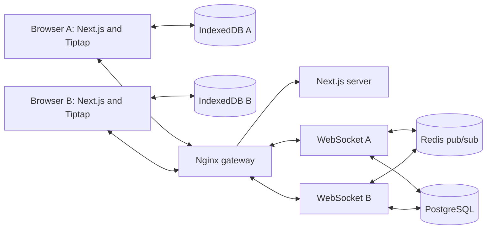

# MergePad

MergePad is a collaborative rich-text editor that keeps working when a browser loses its connection. Two people can edit the same document, see each other's cursors and selections, and reconnect with both sets of changes intact.

## Run it

Install Podman and a Compose provider (`podman-compose` works). On macOS or Windows, start the Podman VM with `podman machine start` first (initialize it once with `podman machine init` if necessary).

```sh
podman compose up -d --build
```

Open [localhost:3000](http://localhost:3000). Stop the stack with `podman compose down`; the named PostgreSQL volume survives. Adding `-v` deletes the stored documents.

If port 3000 is taken, run `MERGEPAD_PORT=3010 PUBLIC_ORIGIN=http://localhost:3010 podman compose up -d --build` and open [localhost:3010](http://localhost:3010). Set `TEST_WEB_URL` to that URL for the browser test. If the Podman VM runs out of memory while building both images, build them one at a time (`podman compose build server-a`, then `podman compose build web`) before starting the stack.

The published Redis and PostgreSQL host ports can be overridden with `MERGEPAD_REDIS_PORT` and `MERGEPAD_POSTGRES_PORT` if they are already in use. The containers still use the standard ports internally.

For frontend/backend development outside the containers, use Node.js 22+ and pnpm 10.20.0. Stop the full stack before running these commands to free port 3000.

```sh
podman compose up -d postgres redis
pnpm install --frozen-lockfile
NEXT_PUBLIC_WS_URL=ws://localhost:4000/ws pnpm dev
```

Next.js proxies development API calls to port 4000; WebSockets use the URL above. The Compose build instead uses same-origin HTTP and WebSockets through Nginx. Use the `localhost` hostname or set `PUBLIC_ORIGIN` to your actual browser origin when starting the backend.

## Architecture



- **CRDT over OT.** Tiptap edits a Yjs document. Reconnecting peers exchange state vectors to send missing operations instead of replacing the document. Yjs merges concurrent edits deterministically and handles duplicate updates. Unlike a conventional server-sequenced OT design, this fits independently editable offline replicas without a central transform queue. The tradeoffs are metadata overhead and convergence that does not guarantee editing intent.
- **Fan-out without sticky sessions.** Each WebSocket instance owns only its active rooms and broadcasts local changes to sibling instances over Redis. Redis is ephemeral: document updates are committed before publication, and connection failures trigger reconnect/state-vector recovery. Awareness is intentionally not stored; new rooms query other instances for active guests, and Yjs awareness expires stale remote sessions.
- **Durable snapshots.** A short write window batches updates. PostgreSQL row locking serializes writers for each document; every batch folds into a single binary Yjs snapshot. Binary merge preserves updates that arrive before their dependencies. This avoids replaying an unbounded update log, but it does not garbage-collect tombstones on disk; very large or hot rooms need a different persistence strategy.
- **Operational limits.** The server checks browser origins, bounds WebSocket connections, frame size, per-peer message rate, pending writes, and snapshot size (2 MiB), and disconnects slow readers. Each server exposes readiness (`/healthz`), Prometheus-format metrics (`/metrics`), and structured stdout logs. Shutdown drains pending writes within a bounded grace period.

## Two-minute demo

1. Create a document and copy its link into a private window. Give the two guests different display names.
2. Select a phrase in the first window and watch the named selection in the second. Type bold text in one window and watch it appear in the other.
3. Use your browser's network tools to take only the first window offline. Append `Draft written offline` there and `Live teammate note` in the second window.
4. Bring the first window back online. Both edits should appear in both windows. Reload to verify persistence.
5. Run `pnpm test:integration` against the Compose stack to prove separate server instances are involved, rather than relying on load-balancer placement.

## Verification

```sh
pnpm lint
pnpm typecheck
pnpm build
pnpm test
pnpm test:integration
pnpm exec playwright install chromium
pnpm test:e2e
```

Unit tests cover wire validation and rate limits. The integration suite connects directly to ports 4001 and 4002, confirms distinct instance IDs, disables local broadcast, and verifies Redis fan-out, presence, offline convergence, and Postgres recovery. The browser test requires the gateway on port 3000 and verifies rich text, remote carets, and unsent edits surviving tab closure in IndexedDB. GitHub Actions runs all three test layers.

## Deployment boundaries

This is a **trusted demo workspace**, not a private multi-tenant service. Guest names are self-asserted; all documents in the workspace are visible and editable. Add authenticated sessions, document ACLs, TLS, per-IP abuse controls, backups, and monitoring before public deployment. The documented connection state describes the Yjs handshake, not a per-edit durability acknowledgment. Offline editing works in an open document; there is no service worker to serve pages during an offline hard refresh, and browser storage can be disabled or evicted. No throughput or load-test claims are made.
